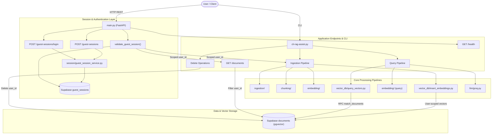
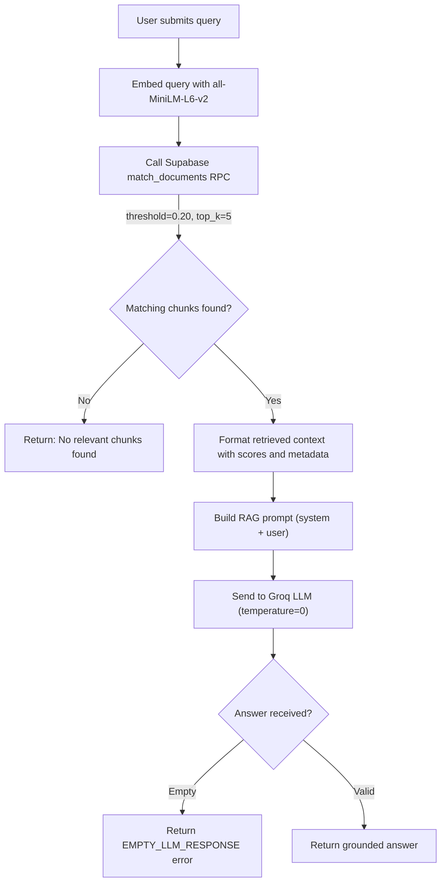
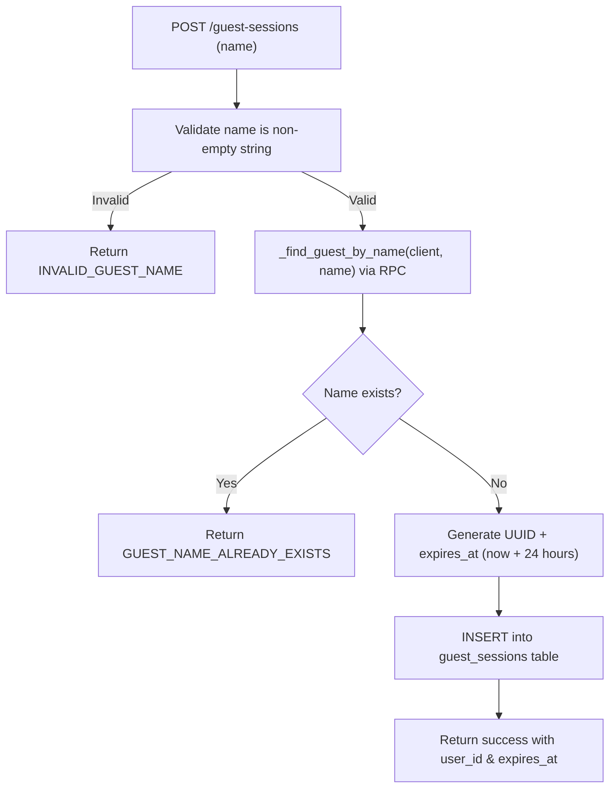
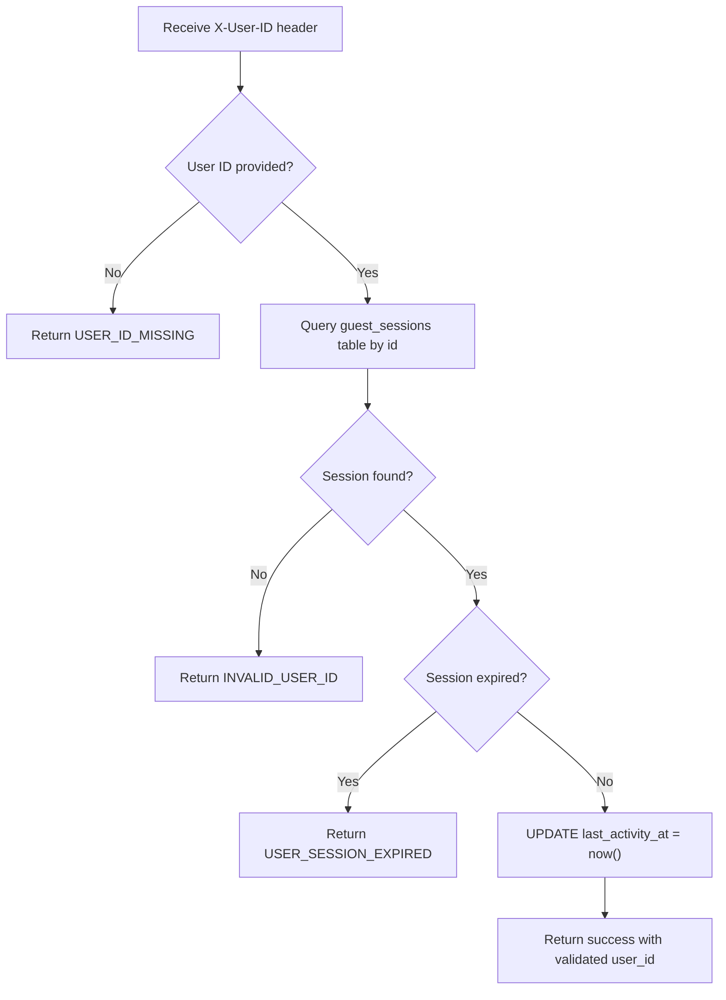
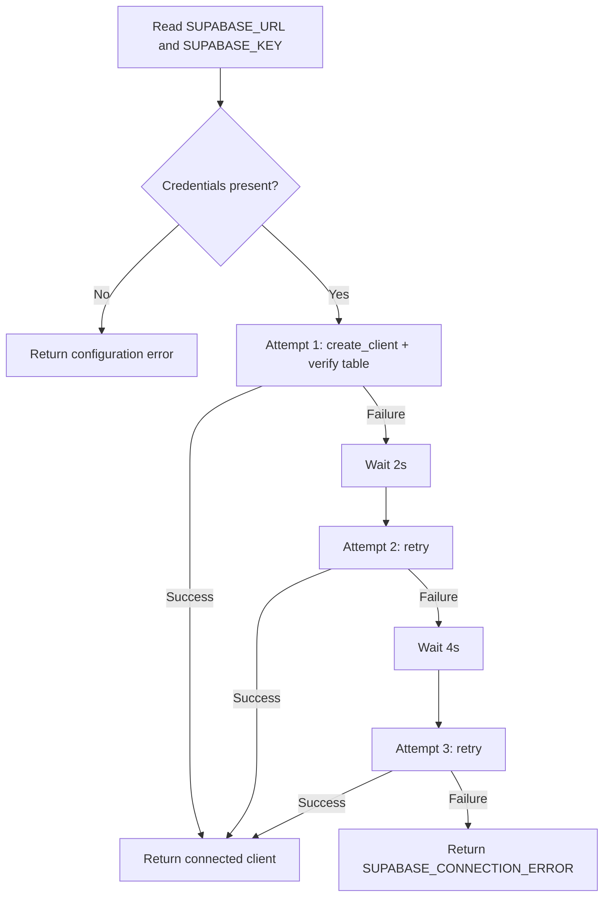
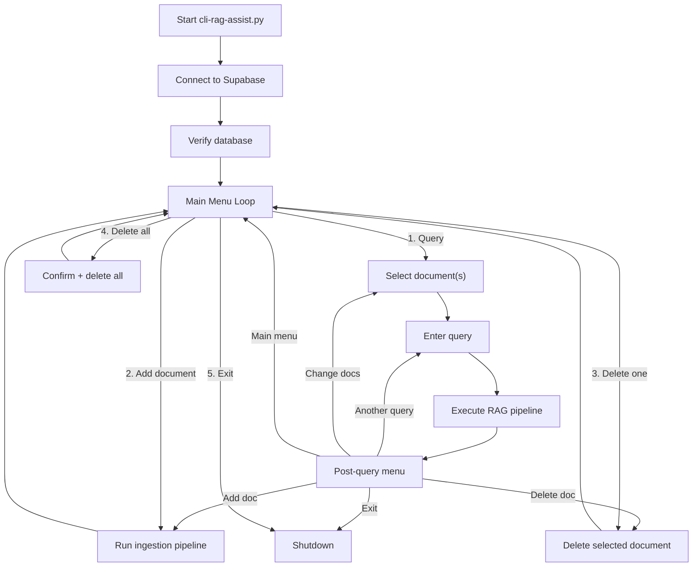
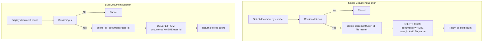
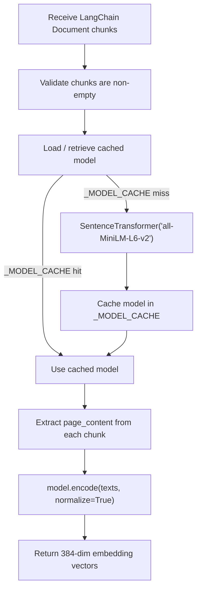
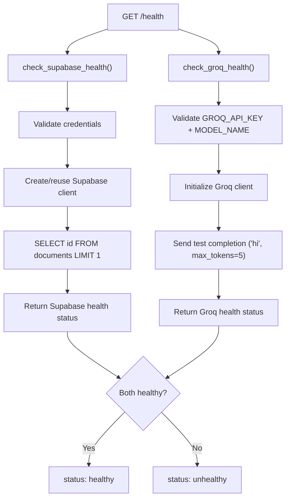

# AI RAG Assist — Architecture & Process Flows

> Auto-generated flow diagrams. Reflects the current state of the codebase.

---

## 1. Overall System Architecture



The system has two interfaces: an interactive **CLI** (`cli-rag-assist.py`) and a **FastAPI backend** (`main.py`). The API provides guest session lifecycle management (`/guest-sessions` for registration, `/guest-sessions/login` for returning users) and scopes all document ingestion and listing operations by `user_id`. Supabase serves as both the relational session store (`guest_sessions`) and the vector database (`documents` with pgvector).

---

## 2. Document Ingestion Pipeline

```mermaid
flowchart TD
    A["Receive Document (file path or upload)"] --> B["detect_file_type()"]
    B -->|Unsupported| X1["Return UNSUPPORTED_FILE_TYPE error"]
    B -->|PDF detected| C["extract_pdf_text()"]
    C -->|Extraction failed| X2["Return PDF_EXTRACTION_ERROR"]
    C -->|Success| D["Page-by-page LangChain Documents with metadata"]
    D --> E["recursive_character_chunking()"]
    E -->|No chunks| X3["Return NO_CHUNKS_GENERATED error"]
    E -->|Chunks created| F["embed_chunks()"]
    F -->|Model load failed| X4["Return EMBEDDING_MODEL_ERROR"]
    F -->|Encoding complete| G["384-dim normalized embeddings"]
    G --> H["insert_documents()"]
    H -->|Batch insert (size=25)| I[("Supabase documents table")]
    H -->|Insert failed| X5["Return SUPABASE_INSERTION_ERROR"]
    I --> J["Return success with stats"]
```

Both the CLI and FastAPI pipelines follow identical stages: **detect → extract → chunk → embed → insert**. The FastAPI path additionally validates the guest session via `X-User-ID`, scopes vectors by `user_id`, and manages temporary upload storage.

---

## 3. RAG Query Pipeline



The query pipeline embeds the user's question using the same model used during ingestion, searches Supabase via the `match_documents` PostgreSQL RPC function, and passes the top-k results to Groq for grounded answer generation.

---

## 4. FastAPI Request Lifecycle (API Endpoints)

```mermaid
flowchart TD
    subgraph "POST /guest-sessions (Registration)"
        R1["Receive name"] --> R2["connect_to_supabase()"]
        R2 --> R3["register_guest(client, name)"]
        R3 --> R4["Return 24h UUID session token"]
    end

    subgraph "POST /guest-sessions/login (Login)"
        L1["Receive name + user_id"] --> L2["connect_to_supabase()"]
        L2 --> L3["login_guest(client, name, user_id)"]
        L3 --> L4["Return validated session status"]
    end

    subgraph "POST /run-pipeline (Upload & Ingestion)"
        A1["Receive file upload(s)"] --> A2["Connect to Supabase"]
        A2 --> A3["Validate X-User-ID guest session"]
        A3 -->|Invalid| A4["Return session error"]
        A3 -->|Valid| A5["For each file: run ingestion pipeline"]
        A5 --> A6["Cleanup temp files"]
        A6 --> A7["Return per-file results"]
    end

    subgraph "GET /documents (List User Documents)"
        B1["Receive request"] --> B2["Connect to Supabase"]
        B2 --> B3["Validate X-User-ID guest session"]
        B3 -->|Invalid| B4["Return session error"]
        B3 -->|Valid| B5["list_documents(user_id)"]
        B5 --> B6["Return user's documents"]
    end

    subgraph "GET /health (Service Health Check)"
        C1["Receive request"] --> C2["check_supabase_health()"]
        C2 --> C3["check_groq_health()"]
        C3 --> C4["Return health status"]
    end
```



---

## 5. Guest Session Lifecycle & Validation

### 5.1 Guest Registration Flow (`POST /guest-sessions`)



### 5.2 Guest Login Flow (`POST /guest-sessions/login`)

```mermaid
flowchart TD
    A["POST /guest-sessions/login (name, user_id)"] --> B["Validate name & UUID format"]
    B -->|Invalid| C["Return INVALID_GUEST_CREDENTIALS"]
    B -->|Valid| D["SELECT id, name, expires_at WHERE id = user_id"]
    D --> E{Session found & name matches?}
    E -->|No| F["Return INVALID_GUEST_CREDENTIALS"]
    E -->|Yes| G{expires_at > now()?}
    G -->|Expired| H["Return USER_SESSION_EXPIRED"]
    G -->|Active| I["UPDATE last_activity_at = now()"]
    I --> J["Return login success with active session"]
```

### 5.3 Request Session Validation (`validate_guest_session`)



---

## 6. Supabase Connection with Retry Logic



The `connect_to_supabase()` function implements exponential backoff (2s, 4s) across up to 3 connection attempts.

---

## 7. CLI Interactive Session Flow



---

## 8. Document Deletion Flow



Both deletion functions scope operations to the specific user_id, ensuring user-level data isolation.

---

## 9. Embedding Generation Flow



The model is loaded once and cached in-memory for the lifetime of the process, avoiding redundant weight loading.

---

## 10. Health Check Flow


